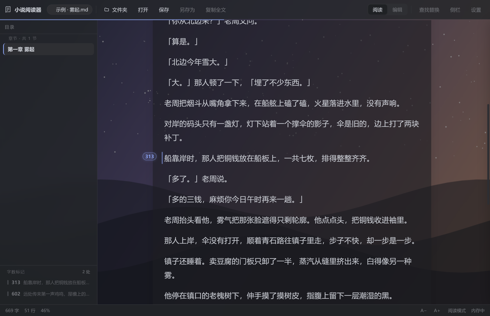
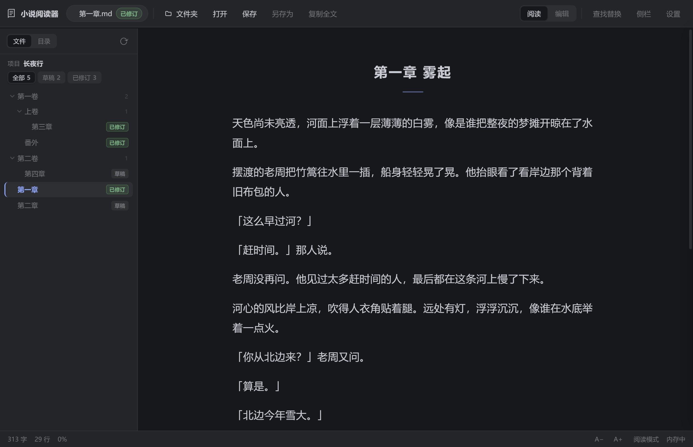
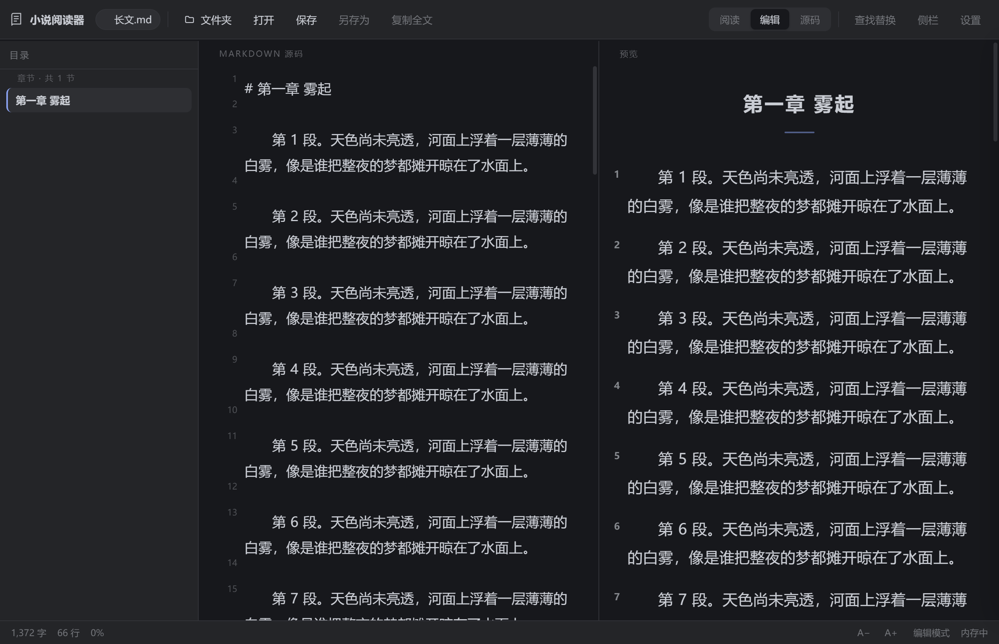
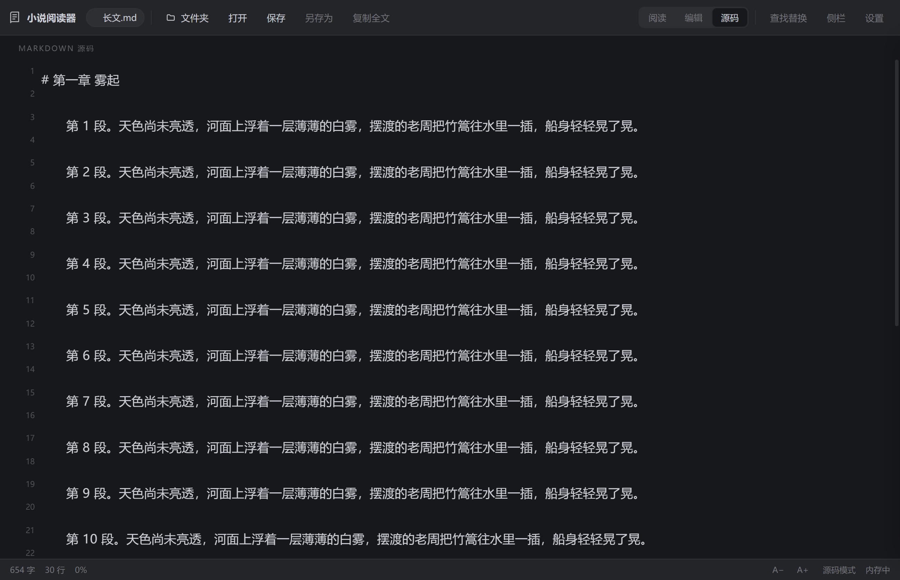

<p align="center"></p>

# Markdown 小说阅读器

一个用来读、也用来写**中文长篇小说**的 Markdown 阅读器。

纯前端单文件实现（`markdown-novel-reader.html`，零依赖、离线可用），另附 Electron 打包的 Windows 便携版 exe。为长篇连载做了几件别处不太常见的事：**按段落打字数标**、**文件夹层级文件树**、**草稿 / 已修订**标记、**背景皮肤**。



---

## 功能

| 功能 | 说明 |
| --- | --- |
| **章节字数标** | 每 N 字（默认 2000）在"跨过这个字"的那一段落上打标。标挂在段落左侧空白处，数字是**这一段结束时的真实字数**，一条竖线贯穿整段。左栏不够宽时自动退回段末。侧栏列出所有标，点一下跳过去，源码栏同步滚动到同一位置。 |
| **文件夹层级** | 打开文件夹即成为一个项目，左侧按真实目录层级缩进展示，可逐级折叠；「第X卷 / 第X章 / 番外」按中文数字正确排序，不会把第二卷排到第一卷前面。 |
| **草稿 / 已修订** | 每个文件可手动标成"草稿"或"已修订"，按状态筛选，重启后仍然记得。 |
| **阅读 / 编辑双栏** | 默认进编辑模式（左源码、右实时预览），切到阅读就是纯净正文。打开下一个文件会沿用上一个文件的模式，重启后也记得。 |
| **自动保存** | 停手约 1 秒就写回原文件，不用按 Ctrl+S。切文件、切模式、切到别的窗口、关窗都会顺手落一次盘，状态栏显示「已自动保存 16:24:05」。写盘失败会退回草稿并提示，不会静默丢字。设置里可关。 |
| **外部改动同步** | 文件被 AI、其他编辑器或别的程序改过，会自动读回最新内容，不用关开文件；跑着的时候约 2 秒发现一次，切回窗口也会立刻检查。若你这边正好有没保存的改动，会停下来问「载入磁盘版本 / 保留我的改动」，不会闷头覆盖。顶栏「刷新」（`Ctrl+R`）可随时手动重读，顺带重扫侧栏文件树。 |
| **源码全屏** | 顶栏「源码」按钮（或 `Ctrl+Shift+E`）把源码铺满整个窗口，隐藏预览与侧栏，专心码字。源码带行号，滚到哪都跟得上，光标所在行会高亮。 |
| **段落号** | 可开关。开启后每段左侧标一个小数字（标题、列表项不编号），和字数标分两列并排、互不遮挡，对稿时可以直接说"第 31 段"。 |
| **复制** | 一键复制全文；选中任意文字会浮出「N 字 · 复制」小胶囊，直接复制选区。 |
| **背景皮肤** | 上传自己收藏的图做背景，可调浓度、模糊、压暗、正文衬底，保证字仍看得清。多张皮肤并存，随时切换。面板/侧栏变成磨砂半透明。 |
| **我的配置** | 配色、版式、皮肤可存成命名配置（如「夜读·紫」「白天·纸白」），一键换回。默认也会自动记录，下次打开原样恢复。 |
| **状态都记得** | 阅读/编辑/源码三态、侧栏收起与否、段落号与行号开关、字号窗口…… 关掉再开就是离开时的样子。 |
| **排版** | 字号、行距、字间距、段间距、正文宽度、字体（黑体/宋体/楷体/等宽）、段首缩进；章节标题自动美化。 |
| **其它** | 查找替换（支持正则与大小写）、目录、阅读进度、拖入文件即读。 |



编辑模式：左源码带行号，右预览带段落号。



源码全屏：`Ctrl+Shift+E`，只剩源码，专心码字。



## 直接用

**Windows（推荐）**：下载仓库 Releases 里的 `Markdown小说阅读器.exe`，双击即用 —— 单文件便携版，不安装、不写注册表，可直接读写本机文件。

**macOS**：下载 Releases 里的 `Markdown小说阅读器-<版本>-arm64.dmg`（Apple 芯片）或 `-x64.dmg`（Intel），拖进「应用程序」。包未做代码签名，首次打开若被拦下，右键图标选「打开」，或到「系统设置 → 隐私与安全性」里点「仍要打开」。

**浏览器**：双击 `markdown-novel-reader.html`。Chrome / Edge 下可以正常打开文件夹并保存；其它浏览器会退化为只读打开（保存时下载副本）。

## 自己打包 exe

需要 Node.js 18+ 与 Windows：

```bash
cd .build
npm install
./build.sh
```

产物在 `dist/`，同时会复制一份到项目根目录。打包流程：目录版打包 → 写图标/版本信息 → 封装成 portable 单文件。

## 自己打包 macOS 版

`.dmg` 依赖 macOS 自带的 `hdiutil` 和 `codesign`，**只能在 Mac 上构建**（Windows / Linux 上做不出来）：

```bash
cd .build
npm ci
./build-mac.sh          # 出 arm64 + x64 的 dmg 与 zip
./build-mac.sh --dir    # 只出 .app，方便本机试跑
```

产物在 `dist-mac/`。没有签名证书时 `identity: null` 会跳过签名，首次打开需要右键 →「打开」。

**没有 Mac 也可以**：仓库带了 GitHub Actions（`.github/workflows/build.yml`），push 到 GitHub 后会自动在 macOS 机器上打出 arm64 / x64 两套 dmg 和 zip，在 Actions 页面的 Artifacts 里下载即可；同一个流程也会顺手打 Windows 的 exe。

## 快捷键

macOS 上 `Ctrl` 换成 `⌘`（`Shift`+`Ctrl` 对应 `⇧⌘`），界面里的按键提示会自动跟着变。

| 按键 | 作用 |
| --- | --- |
| `Ctrl` + `O` | 打开文件 |
| `Ctrl` + `Shift` + `O` | 打开文件夹（作为项目） |
| `Ctrl` + `S` | 保存 |
| `Ctrl` + `R` | 从磁盘重新读取当前文件（顺带刷新文件树） |
| `Shift` + `Ctrl` + `S` | 另存为 |
| `Ctrl` + `E` | 阅读 / 编辑切换 |
| `Ctrl` + `Shift` + `E` | 源码全屏 |
| `Ctrl` + `F` | 查找替换 |
| `Ctrl` + `B` | 显示 / 隐藏侧栏 |
| `Ctrl` + `↑` / `↓` | 调字号 |
| `Ctrl` + `Shift` + `C` | 复制全文 |
| `Ctrl` + `Shift` + `D` | 切换当前文件的草稿 / 已修订 |
| `Esc` | 关闭面板 |

## 数据存在哪

- **浏览器**：设置与草稿在 `localStorage`，皮肤图片与项目句柄在 `IndexedDB`。
- **桌面版**：`%APPDATA%\Markdown小说阅读器\`
  - `state.json` — 窗口位置、上次打开的项目
  - `config.json` — 全部阅读设置与「我的配置」（设置面板底部可直接打开所在文件夹）
  - `Local Storage` / `IndexedDB` — 皮肤图片等

## 目录结构

```
.
├── markdown-novel-reader.html   主程序：全部 HTML / CSS / JS 都在这一个文件里
├── docs/                        README 截图
└── .build/                      Electron 桌面版
    ├── main.js                  主进程：开窗、窗口位置兜底、文件读写、config.json
    ├── preload.js               contextBridge：把 fs / 剪贴板 / 配置读写暴露给页面
    ├── package.json             electron-builder 配置（portable 单文件）
    ├── build.sh                 一键构建
    ├── afterPack.js             打包后写图标与版本信息
    ├── make-icon.js             纯代码生成多尺寸 icon.ico
    └── ui-*.js                  真机 Electron 自测脚本（字数标、跳转、复制、皮肤…）
```

## 说明与限制

- 桌面版目前只提供 Windows x64 构建。
- 只在 Chromium 内核（Chrome / Edge / Electron）下验证过；Firefox、Safari 未测。
- 皮肤图片存放在本机 IndexedDB，不进配置文件，也不会上传。

## License

MIT
